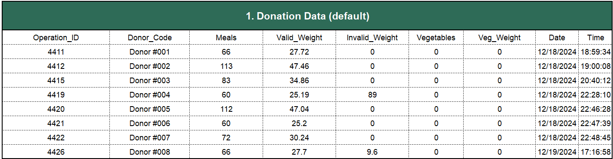
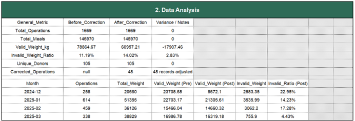
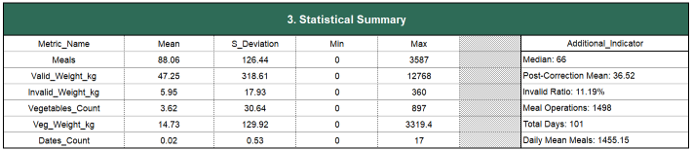
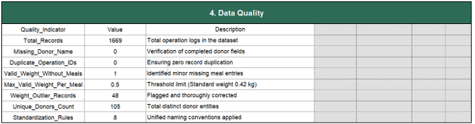
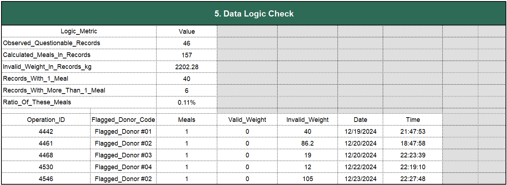
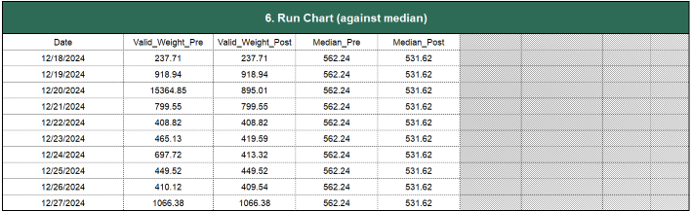

# 🍱 Taami Project - Food Data Analysis & Operational Insights
This project analyzes operational records from **Taami (Food Preservation Charity)** to identify donation trends, uncover the root causes of food waste, and provide insights to optimize food distribution, reduce waste, and enhance community food security.

> **Privacy Note:** This project uses real operational data provided by Taami. All personal information and private entities have been anonymized in compliance with data privacy policies. Only sample aggregated insights and structural frameworks are shared publicly.

---

## 📌 Project Overview & Objectives
The primary goal is to convert raw administrative logs into strategic metrics that support decision-making:
- **Descriptive & Diagnostic Analysis:** Summarize historical donation flows and diagnose anomalies (such as data-entry errors and decimal-placement issues).
- **Waste Reduction:** Minimize invalid food quantities and track waste patterns over time.
- **Donor Performance:** Identify key donors contributing the highest rates of valid meals versus waste.
- **Operational Efficiency:** Structure metrics by day, week, and month.

---
## ⚙️ Methodology & Data Framework

This project leverages two core analytical methodologies:

1. **Descriptive Analysis:** Organizes and summarizes historical data to answer “What happened?”
2. **Diagnostic Analysis:** Pinpoints the root causes behind data anomalies and waste spikes to answer “Why did it happen?”

### Approved Excel Workbook Structure:
Following the transition from exploratory Python prototypes, the complete analysis is structured into multiple dedicated sheets within Excel:

* **`Donation Data:`** The core primary dataset containing raw entries and corrective adjustment columns.
* **`Data Analysis:`** Comprehensive data audit showing comparisons "Before and After Correction".
* **`Statistical Summary:`** Key metrics including Mean, Standard Deviation, Max/Min values, and Medians.
* **`Data Quality:`** Supplementary sheet measuring utilization rates and data engineering metrics.
* **`Data Logic Check:`** Tracks and resolves flagged records to minimize logical discrepancies.
* **`Run Chart:`** Tracks daily valid weights across 101 days against the Median line.
---
## 🚀 Project Timeline & Phases

### Phase 1: Initial Discovery & Data Cleaning (Aug – Oct 2025)
* **Status:** ✅ Completed
* **Scope:** Cleaned and structured raw logs covering **101 operational days** (Dec 18, 2024 – Mar 29, 2025). Computed baseline daily and weekly averages for valid and invalid donations.

### Phase 2: Deep-Dive Diagnostics & Final Reporting (Sep – Nov 2026)
* **Status:** ✅ Completed
* **Scope:** Conducted thorough error corrections (such as fixing decimal placement anomalies in 48 flagged records, e.g., correcting record #4460 from 12,768 kg to 127.68 kg). Evaluated monthly growth trends and finalized comprehensive reporting for the charity’s leadership.

---
## 🛠️ Tools and Technologies
| Tool / Technology | Purpose |
| :--- | :--- |
| **Excel** | Data cleaning, validation, statistical aggregation, and multi-sheet reporting |
| **Python (Pandas / NumPy)** | Initial data exploration, text filtering, and preprocessing logic |
| **ChatGPT / Gemini / Copilot** | Conceptual structuring, formula syntax guidance, and workflow organization |
| **GitHub** | Version control, documentation, and project portfolio hosting |

---

## 📊 Sample Visualization & Key Analytical Terms

*Below is an illustrative sample visualization comparing valid and invalid food quantities across the 101-day timeline. Detailed explanations for key analytical terms and metrics shown in the images are provided below.*

`1. Donation Data Sample:`

> `Operation ID:` A unique serial number assigned to each individual donation transaction log.
> 
> `Donor Code:` An anonymized identifier (e.g., Donor #001) assigned to protect charity privacy.
> 
> `Valid Weight / Invalid Weight:` The measured weight (in kilograms) of food donations classified as edible/safe for distribution versus spoiled/unusable waste.

`2. Data Analysis Sample:`

> `Before Correction / Pre:` Raw data as originally recorded, prior to auditing or fixing errors.
>
> `After Correction / Post:` Cleaned data after resolving anomalies and standardizing calculations.

`3. Statistical Summary Sample:`

> `Mean:` The mathematical average of the dataset values.
> 
> `S_Deviation (Standard Deviation):` Measures the amount of variation or dispersion of the dataset values.
> 
> `Min / Max:` The minimum and maximum recorded values within the dataset.
> 
> `Median:` The middle value that separates higher and lower halves, less affected by outliers.

`4. Data Quality Sample:`

> `Quality Indicator:` Specific data auditing metrics used to evaluate dataset integrity (e.g., duplicate checks, missing values).
> 
> `Threshold Limit:` A predefined boundary rule (e.g., standard maximum weight per meal at 0.42 kg) used to flag suspicious entries.
> 
> `Weight Outlier Records:` Data entries containing extreme or abnormal values that required correction.

`5. Data Logic Check Sample:`

> `Observed Questionable Records:` Flagged rows that failed logical consistency rules and required manual inspection.
>
> `Flagged Donor Code:` Anonymized tags for records identified during the logical auditing phase.

`6. Run Chart Sample:`

> `Run Chart:` A specialized line graph tracking sequential process measurements over time (days).
>
> `Median Pre / Median Post:` The middle baseline reference value of valid weights compared before and after data corrections.

---

## 🔮 Future Recommendations for the Charity

While Phase 1 & 2 (Data Cleaning, Descriptive & Diagnostic Analysis) are fully completed, the following steps are recommended for the charity to implement in future data phases:
- **Predictive Modeling:** Leverage historical donation trends to forecast future food surplus and seasonal shortages.
- **Automated BI Dashboards:** Implement real-time interactive dashboards (e.g., Power BI or Tableau) for recurring monthly management reviews.
- **Advanced Data Collection:** Standardize input logs across all branches to minimize data entry discrepancies (such as decimal placement errors).

---

*Developed as part of an applied data analytics initiative supporting the non-profit sector.*
